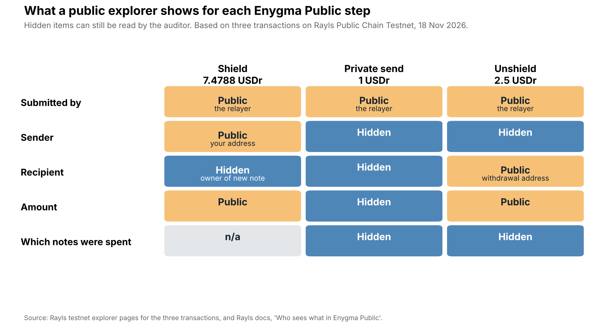

# Rayls Enygma Public: what a block explorer shows

Three transactions on the Rayls Public Chain Testnet on 18 November 2026, compared with Rayls' documentation of who sees what in Enygma Public.

Article: (add the link here after you publish it)

## The transactions

| Step | Amount | Time (UTC) | Transaction hash |
| --- | --- | --- | --- |
| Shield | 7.4788 USDr | 13:27 | `0xc79196db5e1aa7defcb68372164f75d69d15e2845929284aa4c35abdea6eedf1` |
| Private send | 1 USDr to @kratos | 13:34 | `0xe306fc5d905d58765eeecd6d9871beab8a2ab9246a5f6692540138c3a80a9464` |
| Unshield | 2.5 USDr | about 13:36 | `0x5d33ba5bc55806608c9234fe3c37de27bc4cd1083ca49e0528c1da2146bc195c` |

## What the explorer showed

- **Shield:** sent by the relayer (`0xa5f0...0Ac8`) calling a contract with a value of zero. The page lists a transfer of 7.4788 USDr from my address that ends in the vault, and the logs name my address as the authorizer. My address and the amount are public. Who owns the new private note is not shown, only a commitment and an encrypted note.
- **Private send:** sent by the relayer, calling a contract with a value of zero. The summary page has no token-transfer line. The logs I scrolled through held only vault events (a nullifier, commitments and encrypted notes), with no address of mine, no recipient address and no amount.
- **Unshield:** sent by the relayer. The page lists a transfer of 2.5 USDr from the vault to my public address, so the receiving address and the amount are public. Which notes paid is not shown.

This matches Rayls' documentation of who sees what in Enygma Public.

## Files

- `enygma_a_shield_explorer.jpg`: shield summary, with the relayer as From and the tokens-transferred line.
- `enygma_b_shield_logs.jpg`: shield logs, with the Transfer and AuthorizationUsed events and the depositor's address.
- `enygma_c_send_explorer.jpg`: private send summary, with the relayer as From and no tokens-transferred line.
- `enygma_d_unshield_explorer.jpg`: unshield summary, with 2.5 USDr from the vault to the public address.
- `enygma_e_app_panel_send.jpg`: the demo app's own "What the explorer shows" panel for the private send.
- `enygma_who_sees_what.png`: the summary graphic above.

The screenshots are frames from a screen recording of the testnet demo.

## Verify it yourself

Open each transaction hash on the Rayls testnet explorer and check:

1. **From** is the relayer in all three.
2. The shield and unshield pages have a **Tokens transferred** line with an address and an amount. The private send does not.
3. In the shield's **Logs** tab, find the Transfer and AuthorizationUsed events with the depositor's address. In the private send's **Logs** tab, look for any address of yours or the amount. You should find vault events only.

## Limits

- Three transactions on a testnet pilot. Behaviour on mainnet, or after updates, may differ.
- I read the explorer's decoded fields and logs by eye. I did not search the raw transaction bytes.
- I did not test the auditor view, verify the proofs, or read the contract code.
- This covers Enygma Public. Enygma Sovereign runs on institutions' own Sovereign Chains and does not appear on a public explorer.
